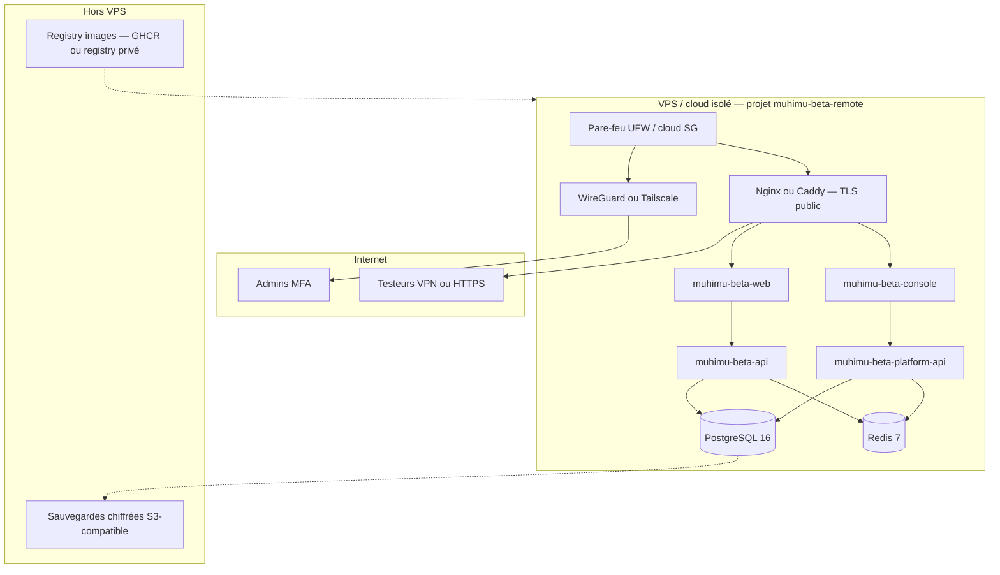

# Architecture — MUHIMU Accounting BETA distante

**Référence :** BETA-REMOTE-ARCH-01  
**Statut :** **conception uniquement** — aucun déploiement autorisé sans GO d’implémentation  
**Date :** 2026-10-15

---

## 1. Objectifs

| Objectif | Détail |
|----------|--------|
| **Isolation** | Environnement **dédié**, distinct de DEV, bêta locale (`muhimu-beta` loopback) et **production future** |
| **Public cible** | Petit panel d’**experts-comptables** distants (5–15 utilisateurs simultanés max, ordre de grandeur) |
| **Données** | **100 % fictives** — SYSCOHADA OHADA, états **non certifiés** |
| **Réutilisation** | Images et `docker-compose.beta.yml` comme **base** ; overlay remote pour TLS, secrets, VPN, observabilité |

---

## 2. Vue d’ensemble

---

## 3. Composants

### 3.1 Compute

| Composant | Rôle | Exposition |
|-----------|------|------------|
| **VPS unique** (phase 1) | Hôte Docker Compose | IP publique **minimale** (443, 51820 UDP VPN) |
| **Services** | Alignés sur `docker-compose.beta.yml` : `db`, `redis`, `migrate` (one-shot), `backend`, `platform`, `frontend`, `console`, `proxy` | **Seul** le proxy (443) vers Internet ; DB/Redis **réseau bridge interne** |

**Évolution :** séparer DB managée (option B) avant montée en charge > ~30 utilisateurs actifs.

### 3.2 Images versionnées

| Image | Tagging recommandé |
|-------|-------------------|
| `muhimu-beta-api` | `beta-remote-YYYYMMDD-<git-sha>` |
| `muhimu-beta-platform-api` | idem |
| `muhimu-beta-web` / `console` | idem |

- Build CI à partir du **tag release** validé (même commit que bêta locale closeout).
- **Interdit :** `:latest` seul en production remote sans pin digest.

### 3.3 Réseau

| Couche | Mesure |
|--------|--------|
| **Pare-feu hôte** | Deny all inbound sauf **443/tcp**, **51820/udp** (VPN), **22/tcp** depuis IP admin **ou** SSH uniquement via VPN |
| **PostgreSQL / Redis** | **Aucun** port publié (`ports:` absent, comme bêta locale) |
| **Proxy** | Terminaison TLS, headers `X-Forwarded-*`, `AUTH_TRUST_PROXY=1` |
| **Accès testeurs** | **Recommandé phase 1 :** HTTPS public sur FQDN + comptes nominatifs + rate-limit ; **Recommandé renforcé :** accès ERP **via VPN** (split tunnel) + HTTPS cert valide sur FQDN interne VPN |

### 3.4 TLS

| Élément | Choix |
|---------|--------|
| Certificats | **Let’s Encrypt** (HTTP-01 ou DNS-01) ou certificat org |
| FQDN | Ex. `erp.beta.muhimu.tech`, `console.beta.muhimu.tech` (**décision DNS — accord requis**) |
| Renouvellement | Certbot + reload nginx **ou** Caddy automatique |
| Cookies | `SESSION_COOKIE_SECURE=1`, `CSRF_COOKIE_SECURE=1`, politique SEC-SESSION-01 |

### 3.5 Secrets

| Secret | Stockage (recommandé) |
|--------|------------------------|
| `DJANGO_SECRET_KEY`, mots de passe PG | Fichier **`.env.beta.remote`** sur hôte (**chmod 600**, hors Git) **ou** coffre (Bitwarden Secrets / 1Password / SOPS+age) |
| Mots de passe testeurs | Provisioning one-shot ; rotation ; **jamais** dans le dépôt |
| Clés VPN | Génération par admin ; révocation par pair |

**Interdit :** réutiliser `.env.beta` local ou mots de passe `BETA_TEST01_*`.

### 3.6 Sauvegardes

| Objet | Fréquence | Rétention |
|-------|-----------|-----------|
| PostgreSQL (`pg_dump -Fc`) | Quotidien | 30 j (daily), 4 weekly |
| Volume `beta_media` | Hebdo | 4 semaines |
| `.env` chiffré (backup ops) | À chaque changement secret | 1 an |

**Restore drill :** trimestriel sur instance **éphémère** (pas prod remote).

### 3.7 Supervision

| Signal | Outil (phase 1 pragmatique) |
|--------|----------------------------|
| Disponibilité HTTPS | Uptime Kuma / Better Stack (**estimatif**) |
| Logs applicatifs | `docker compose logs` + rotation ; option Loki + Grafana |
| Disque / CPU | Node exporter ou métriques hébergeur |
| Alertes | Email ops + webhook (seuil disque > 80 %, backend unhealthy) |

### 3.8 Mises à jour et rollback

1. Snapshot DB + note tag images **avant** deploy.  
2. `migrate` one-shot (si migrations approuvées).  
3. Recreate services API/web **sans** prune volumes.  
4. Smoke : health, `run_beta_uat01_probes` équivalent remote, ACC-03 count.  
5. Rollback : restore dump pré-deploy + repin images précédentes.

---

## 4. Séparation des environnements

| Environnement | Rôle | Données |
|-------------|------|---------|
| **DEV** (`muhimuerp`) | Développement | Local / demo @muhimu.local |
| **Bêta locale** | UAT ops loopback | `beta-test-01` (peut contenir bruit demo ex. 119 M) |
| **Bêta remote** | Testeurs experts | **Jeu neuf** `beta-remote-demo-*` (voir § demo data doc) |
| **Production future** | Clients réels | **Autre** infra, **autre** base, RLS identique |

---

## 5. Décisions requérant votre accord

| # | Décision |
|---|----------|
| D1 | FQDN et registrar (sous-domaines beta) |
| D2 | Modèle accès testeurs : **HTTPS public** vs **VPN obligatoire** |
| D3 | Option infra A (VPS Compose) vs B (cloud managé) — voir `BETA_REMOTE_COST_ESTIMATE.md` |
| D4 | Hébergeur et juridiction des données (UE vs autre) |
| D5 | Budget mensuel plafond |
| D6 | Date d’ouverture testeurs (après critères §5 checklist sécurité) |

---

## 6. Conditions GO / NO-GO (implémentation future)

| GO implémentation remote | NO-GO |
|--------------------------|-------|
| Checklist sécurité **100 %** items bloquants | MFA admin absent |
| Restore drill **réussi** < 30 j | Pas de backup testé |
| SessionGuard SG-1–SG-6 **validés** | TLS invalide ou self-signed pour testeurs |
| Jeu demo **remote** provisionné (sans copy local) | Credentials local réutilisés |
| GO écrit ouverture testeurs | DNS ouvert sans pare-feu |

---

## 7. Référence technique existante

- Compose : `docker-compose.beta.yml`
- Proxy : `deploy/beta/nginx.conf`, `deploy/beta/generate-certs.sh` (local only — **ne pas** réutiliser certs self-signed remote public)
- Sessions : SEC-SESSION-01 (`docs/audit/SEC_SESSION01_REPORT.md`)
- Closeout local : `docs/audit/BETA_LOCAL_CLOSEOUT_REPORT.md`
